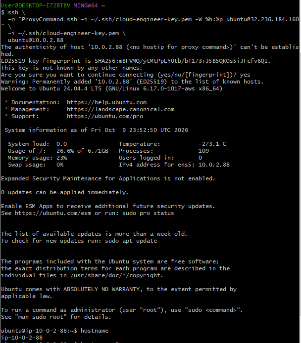
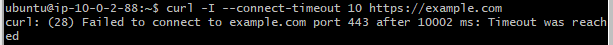

# AWS Networking and Security Lab

## Project Overview

This project involves designing and deploying a custom AWS VPC with public and private subnets, an internet gateway, route tables and security groups.

The objective is to understand how AWS resources communicate and how routing and security settings control network access.

## Planned Configuration

| Resource | Planned configuration |
|---|---|
| Region | Sydney (ap-southeast-2) |
| VPC CIDR | 10.0.0.0/16 |
| Public subnet | 10.0.1.0/24 |
| Private subnet | 10.0.2.0/24 |
| Internet gateway | Attached to custom VPC |
| Public route | 0.0.0.0/0 to internet gateway |
| Private route | Local VPC route only |

## Verified VPC and Subnet Deployment

Created a custom VPC named `cloud-network-lab` in the AWS
Sydney Region (`ap-southeast-2`) with IPv4 CIDR block
`10.0.0.0/16`.

Created two subnets within the VPC:

| Setting | Public subnet | Private subnet |
|---|---|---|
| Name | `cloud-public-subnet` | `cloud-private-subnet` |
| IPv4 CIDR | `10.0.1.0/24` | `10.0.2.0/24` |
| Availability Zone | `ap-southeast-2a` | `ap-southeast-2a` |
| State | Available | Available |
| Auto-assign public IPv4 | Enabled | Disabled |

Both subnet CIDR blocks are contained within the VPC
address range and do not overlap.

At this stage, the subnets have been created but custom
internet routing has not yet been configured or tested.
  
## Project Status

Planning stage. Infrastructure deployment and connectivity tests are pending.

## Verified Internet Gateway and Routing

## Security Group and Connectivity Testing

This is where we'll document your successful SSH and Nginx tests and your security-group incident.

### Internet Gateway

Created an internet gateway named `cloud-lab-igw` and attached it to the custom VPC `cloud-network-lab`.

Confirmed that the internet gateway's state is `Attached` and that it is associated with the intended VPC.

### Public Route Table

Created `cloud-public-rt` and explicitly associated it with `cloud-public-subnet` (`10.0.1.0/24`).

Verified the following routes:

| Destination | Target | Purpose |
|---|---|---|
| `10.0.0.0/16` | Local | Communication within the VPC |
| `0.0.0.0/0` | Internet gateway | Default IPv4 route to the internet |

Automatic public IPv4 assignment is enabled on the public subnet.

### Private Route Table

Created `cloud-private-rt` and explicitly associated it with `cloud-private-subnet` (`10.0.2.0/24`).

Verified the following route:

| Destination | Target | Purpose |
|---|---|---|
| `10.0.0.0/16` | Local | Communication within the VPC |

No default IPv4 internet route has been configured for the private subnet. Automatic public IPv4 assignment is disabled.

### Verification Status

Confirmed in the AWS console that the internet gateway is attached, both route tables contain the intended routes, and each route table is associated with its corresponding subnet.

End-to-end connectivity testing is pending. No EC2 test instances have been deployed for this project yet.

## Cost Management and Resource Cleanup

### Temporary EC2 Instance Cleanup

Following the successful public-subnet connectivity test and security-group incident exercise, the temporary EC2 instance was terminated to prevent unnecessary ongoing compute charges.

The following results were verified in AWS:

| Resource | Verified status |
|---|---|
| EC2 instance (`cloud-network-test-01`) | Terminated |
| Root EBS volume | Deleted |
| Elastic IPs allocated to this lab | None |
| Other unexpected billable resources | None found |
| Displayed AWS bill | USD $0.00 |

### Retained Networking Infrastructure

The following resources were retained for the next private-subnet networking exercise:

- Custom VPC: `cloud-network-lab-vpc`
- Public subnet: `cloud-public-subnet`
- Private subnet: `cloud-private-subnet`
- Internet gateway: `cloud-lab-igw`
- Public route table: `cloud-public-rt`
- Private route table: `cloud-private-rt`
- Security group: `cloud-public-sg`

The retained network has a public subnet with a default route to the internet gateway and a private subnet with a local VPC route only.

### Cost Management

A USD $5 monthly AWS budget was configured for the learning account.

At the time of the cleanup review, the AWS bill displayed USD $0.00. AWS billing information may be delayed, so the account should be checked again after the latest usage has been processed.

### Project Status

The public-subnet deployment, SSH and HTTP connectivity tests, deliberate security-group failure, recovery and temporary EC2 cleanup are complete.

Private-subnet connectivity testing remains the next project milestone.

## Private Subnet Connectivity Testing

A second phase of the networking lab tested access to an
EC2 instance deployed inside the private subnet.

### Bastion Host

A temporary bastion host was deployed in the public subnet.

- Bastion private IP: `10.0.1.88`
- Public subnet: `10.0.1.0/24`
- SSH access: Restricted to My IP
- Security group: `cloud-bastion-sg`

SSH from the Windows workstation to the bastion succeeded.

### Private EC2 Instance

A temporary EC2 instance was deployed in the private subnet.

- Private IP: `10.0.2.88`
- Private subnet: `10.0.2.0/24`
- Public IPv4 address: None
- Security group: `cloud-private-sg`
- SSH source: `cloud-bastion-sg`

The private instance was successfully reached from the
Windows workstation through the bastion host using SSH
ProxyCommand.

The SSH private key remained on the Windows workstation
and was not copied onto the bastion host.

### Private Network Verification

The following tests were completed from the private EC2
instance:

| Test | Result |
|---|---|
| Private IP | `10.0.2.88` |
| SSH through bastion | Successful |
| Linux default gateway | `10.0.2.1` |
| Direct HTTPS access to `example.com` | Timed out |

The private subnet route table contained only the local
VPC route and did not contain a default internet route.

This demonstrated that the private EC2 instance could be
administered through the bastion while remaining without
direct public internet access.

### Evidence

## Public-to-Private Application Traffic

A temporary EC2 instance in the public subnet was used to access a web service running on an EC2 instance in the private subnet.

### Test Architecture

- Public EC2 private IP: `10.0.1.56`
- Private EC2 private IP: `10.0.2.250`
- Private EC2 public IPv4 address: None
- Application port: TCP 80
- Private server security group: `cloud-private-sg`

The private server allowed HTTP traffic from instances associated with `cloud-bastion-sg`.

From the public EC2 instance, `curl http://10.0.2.250` returned:

`Hello from the private subnet`

This verified that an EC2 instance in the public subnet could communicate with an application running in the private subnet using private VPC networking.

### Controlled Failure and Recovery

The HTTP inbound rule was temporarily removed from `cloud-private-sg`.

After the rule was removed, an HTTP request from the public instance to the private instance timed out.

The Python web server remained running and SSH connectivity to the private instance remained available.

This demonstrated that the application itself was healthy and that the failure was caused by the security-group configuration.

The HTTP rule was restored and `curl http://10.0.2.250` again returned:

`Hello from the private subnet`

Application connectivity was successfully restored.

[Read Incident 02](docs/incident-02-private-http-security-group.md)